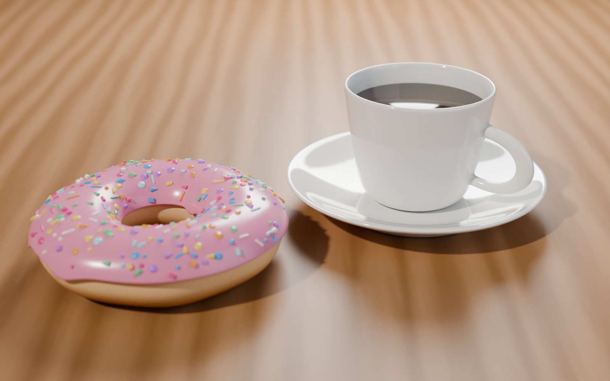
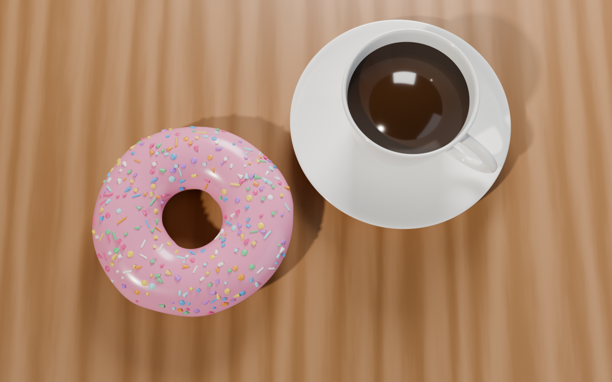
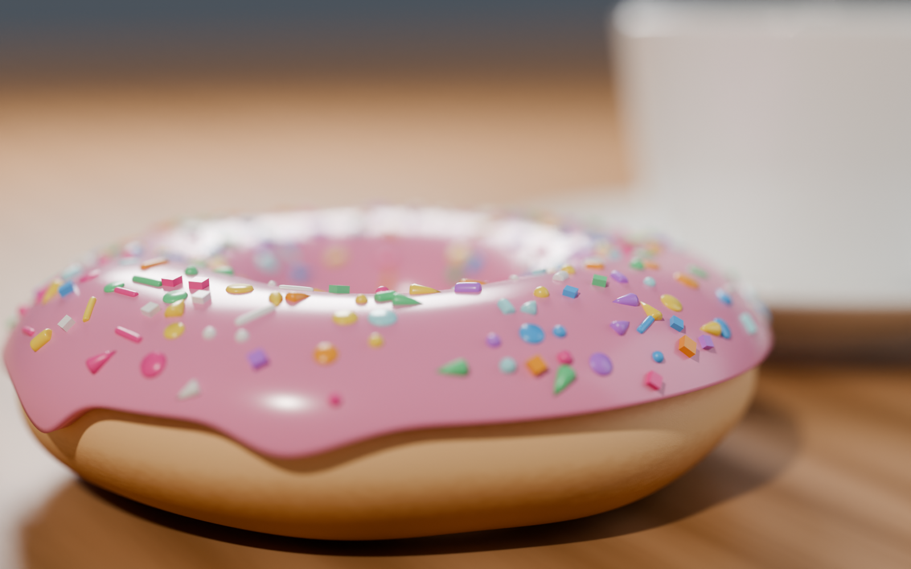

# 1 – Donut, šálek a podšálek

Scéna podle tutoriálu **Blender Guru**:

- [Blender Donut Tutorial Part 1 (2026)](https://www.youtube.com/watch?v=-tbSCMbJA6o)
- [Part 2, Level 3: Complete Modelling](https://www.youtube.com/watch?v=SBtDix7xGOg&list=PLjEaoINr3zgEt_DatH4t_A3u1PpLkK4Lm)

## Soubory

| Soubor | Popis |
| --- | --- |
| `donut.blend` | Blender soubor se scénou (Blender 5.0+) |
| `donut-preview.png` | Kamera 1: hlavní pohled (Cycles, 1600 × 1000) |
| `donut-top.png` | Kamera 2: pohled shora |
| `donut-closeup.png` | Kamera 3: detail donutu s hloubkou ostrosti |

| Shora | Detail |
| --- | --- |
|  |  |

## Postup modelování (principy z videa)

**Donut**
1. Torus (48 × 24 segmentů) + modifikátor *Subdivision Surface*.
2. Nepravidelný tvar: body posunuté „proportional editingem“ (šum podél normál), donut je lehce zploštělý.
3. Materiál těsta: tmavší nahoře a dole, světlejší proužek uprostřed.

**Poleva (Icing)**
1. Duplikát horní poloviny donutu (*Shift+D*, *P → Selection*).
2. Stékající kapky: vybrané body okraje stažené dolů.
3. Modifikátory: *Subdivision Surface → Shrinkwrap* (na donut) *→ Solidify* (tloušťka ~3 mm).

**Posypka (Sprinkles)**
1. Kolekce `Sprinkles` se 6 tvary: dlouhý váleček, krátký váleček, kužel, kulička, kostička
   a plochý disk (konfeta). Kolekce je skrytá.
2. *Geometry Nodes* na polevě: *Distribute Points on Faces* (Poisson) jen na plochách, které míří nahoru,
   *Instance on Points* s *Pick Instance* (náhodný tvar), náhodná rotace kolem normály a náhodná velikost.
3. Jeden společný materiál: *Object Info → Random → Color Ramp* (Constant, 8 barev),
   takže každý kousek posypky má jinou barvu.

**Šálek**
1. Profil válce: vytlačení (*extrude*), zúžení, okraj a vnitřní stěna. Tloušťka stěny je modelovaná.
2. Ucho: dvě plochy na boku se vytlačí ven, smažou a spojí přes *Bridge Edge Loops*
   (14 řezů, smoothness).
3. *Subdivision Surface*, *Shade Smooth*, bílý keramický materiál. Uvnitř je káva.

**Podšálek**
1. Profil válce s prohlubní pro šálek, zvednutým okrajem a spodní nožkou.
2. *Subdivision Surface* a stejný keramický materiál.

## Světla, stíny a kamery

Pod scénou je dřevěný stůl (procedurální textura).

| Světlo | Typ | Účel |
| --- | --- | --- |
| Sun (key light) | Sun, úhel 3° | hlavní teplé světlo zleva, ostré stíny donutu i hrnku |
| Fill light | Area 0,6 m | studené světlo zprava, prosvětlí stíny |
| Rim light | Area 0,3 m | zezadu, světlý obrys polevy a okraje hrnku |

Kamery jsou navázané na timeline markery (snímky 1–3, *Marker → Bind Camera to Markers*):
1. `Camera 1 - main`: 55 mm, hloubka ostrosti
2. `Camera 2 - top`: pohled shora
3. `Camera 3 - closeup`: 70 mm, f/4, ostří na přední okraj polevy

Render: Cycles, 160 samplů, denoising, AgX.
