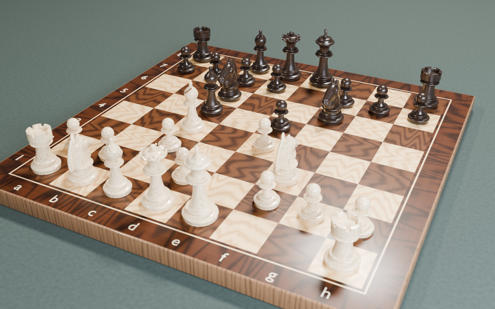
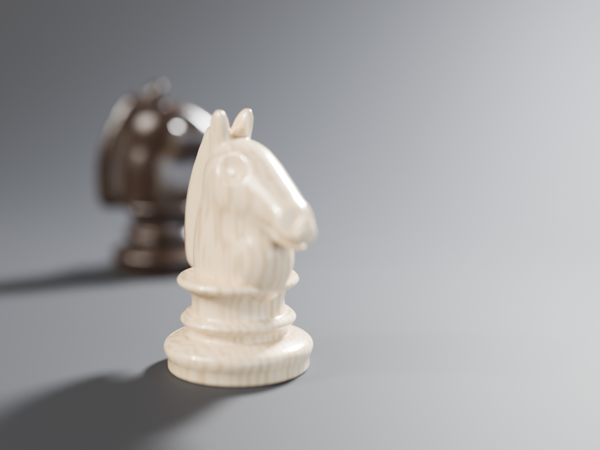
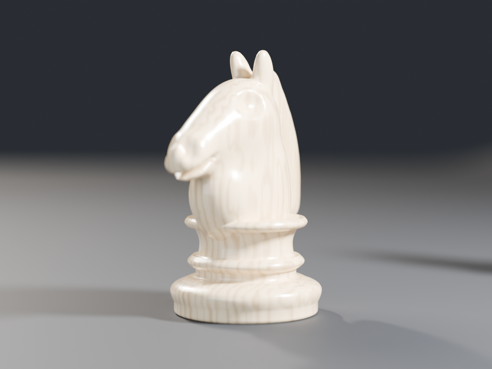
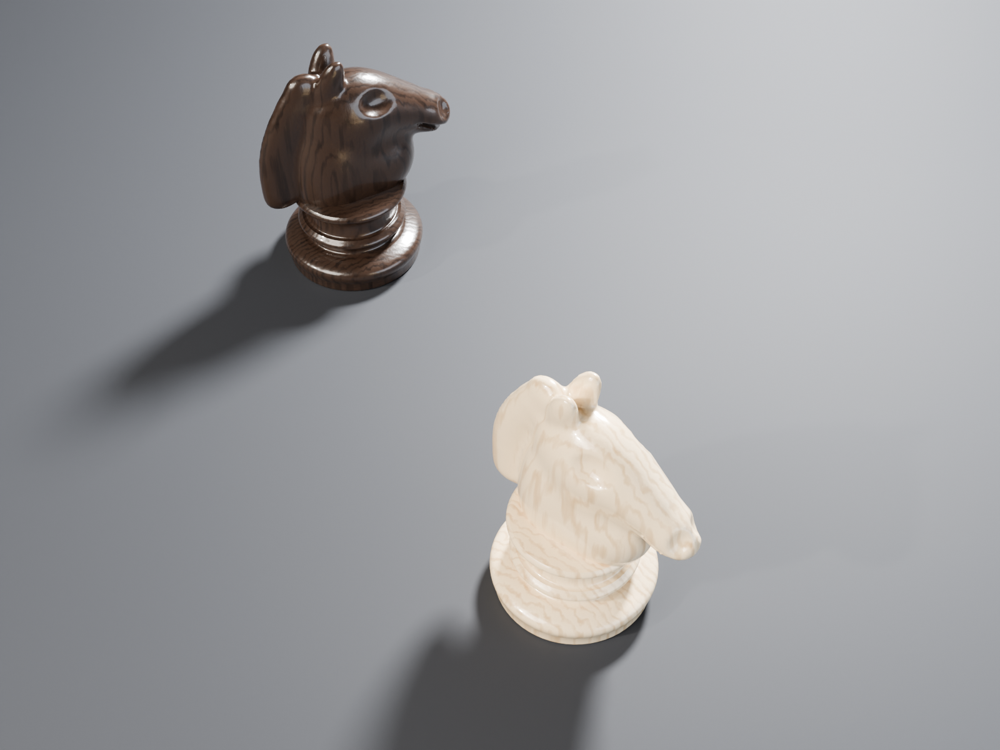
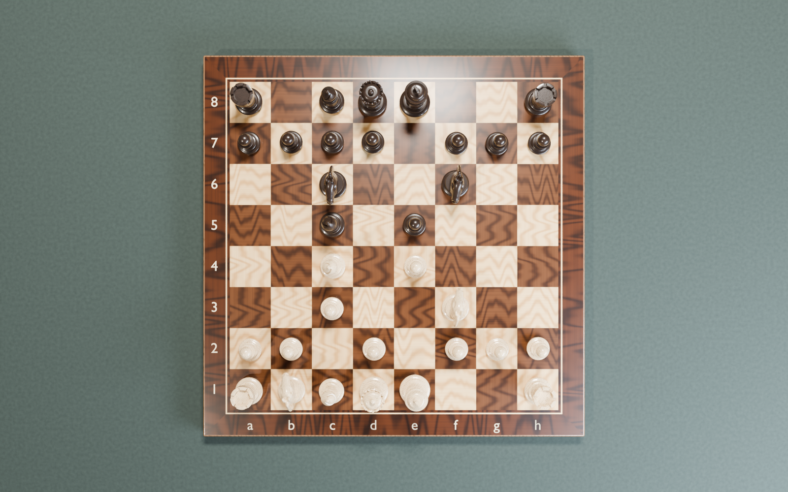
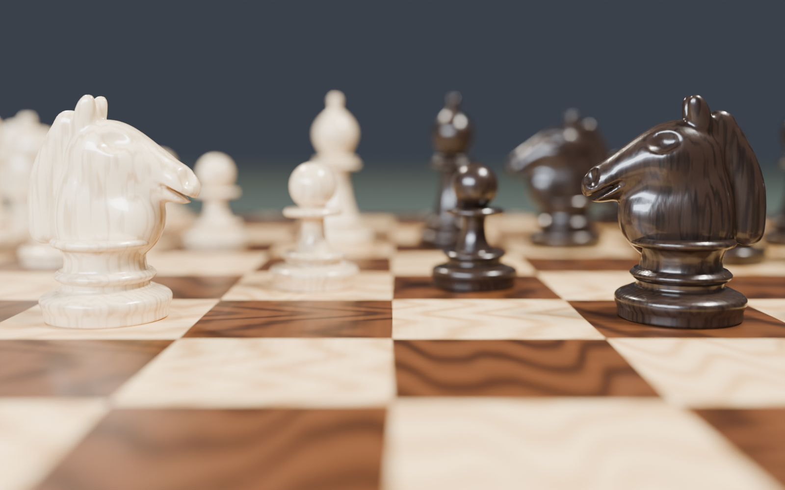
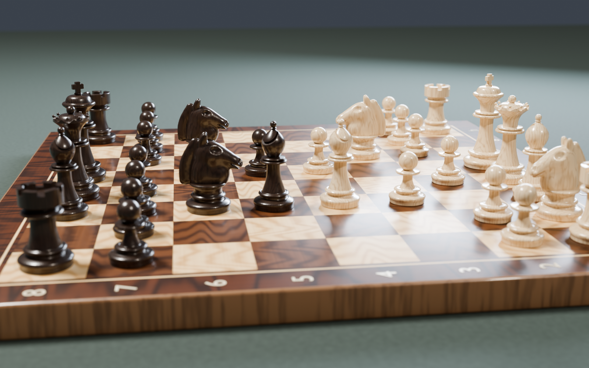

# 2 – Šachy: figurka a šachovnice

Zadání: [PGC – úloha 2](https://mirka.valik.sk/pgc/uloha_2/)

Úloha má dvě části:
1. **Šachová figurka**: vybral jsem **koně**, protože je nejsložitější (organická hlava,
   nedá se celý vytočit z profilu).
2. **Šachovnice**: vytexturovaná deska se všemi 32 figurkami (naduplikované), vlastní
   textury figurek, světla se stíny a několik pohledů kamery.

## Soubory

| Soubor | Popis |
| --- | --- |
| `chess-piece.blend` | Kůň ve studiové scéně (Blender 5.0+) |
| `chess-piece-preview.png` | Kůň: hlavní pohled (Cycles, 1600 × 1200) |
| `chess-piece-profile.png` | Kůň: pohled z profilu |
| `chess-piece-top.png` | Kůň: pohled shora |
| `chessboard.blend` | Šachovnice s figurkami (textura je zabalená uvnitř) |
| `chessboard-preview.png` | Kamera 1: hlavní pohled |
| `chessboard-top.png` | Kamera 2: pohled shora |
| `chessboard-closeup.png` | Kamera 3: detail koní f3 a f6 |
| `chessboard-side.png` | Kamera 4: pohled z boku |

| Kůň | Kůň z profilu | Kůň shora |
| --- | --- | --- |
|  |  |  |

| Šachovnice shora | Detail koní | Z boku |
| --- | --- | --- |
|  |  |  |

---

## Část 1: Šachová figurka (kůň)

**Podstavec (Staunton styl)**
1. Polovina profilu: plocha dna, válcová patka, torus (vypouklý), žlábek (vydutý), korálek,
   krček a límec pod hlavou.
2. Profil roztočený kolem osy Z (*Spin* / modifikátor *Screw*, 64 segmentů).
3. Ostré přechody označené *Mark Sharp*, zbytek *Shade Smooth*.

**Hlava koně**
1. Složená z **metaballů** (elipsoidy), které se plynule slévají: hrudník, krk, lebka,
   lícní kosti, čenich, špička nosu.
2. Uši: dva malé natočené elipsoidy. Hříva: řada 8 elipsoidů po zadní straně krku.
3. Oči, nozdry a tlama: **negativní** metabally, které tvar vyhloubí.
4. Převod na mesh (*Object → Convert → Mesh*), vyhlazení (*Smooth Vertices*) a spojení
   s podstavcem (*Ctrl+J*).

**Studiová scéna**
- Zaoblené pozadí (*cyclorama*), druhý (černý) kůň jako linked duplicate (*Alt+D*).
- Světla:
  - **Sun** (úhel 2,5°): hlavní světlo s ostrým stínem,
  - **Key light** (plošné): měkké přisvětlení zepředu,
  - **Fill light**: studené světlo, prosvětlí stíny,
  - **Rim light** (kruhové, zezadu): obrys hlavy a hřívy.
- Kamery na timeline markerech (snímky 1–3):
  - `Camera - main`: 70 mm, f/4,
  - `Camera - profile`: 85 mm, z boku,
  - `Camera - top`: shora.

## Část 2: Šachovnice

**Deska**
1. Kvádr 51 × 51 × 2,4 cm (pole 5,5 cm, rám 3,6 cm), zkosené hrany (*Bevel*, 3 segmenty).
2. **UV mapování** horní plochy (projekce shora), aby obrázek seděl přesně na desku.
3. **Image Texture** 2048 × 2048 px (zabalená v .blend, *File → External Data → Pack Resources*):
   - světlá pole: javor, tmavá pole: ořech, kresba dřeva se střídá napříč a podél,
   - rám z ořechu a světlá intarzie kolem hrací plochy.
4. Textura jde i do *Bump*, navrchu je lak (*Coat*). Boky rámu mají procedurální ořech.
5. Popisky **a–h** a **1–8** jsou textové objekty (*Add → Text*).

**Figurky**
- 6 modelů: pěšec, věž, střelec, dáma, král a kůň (z části 1).
  - věž: zuby vyříznuté *Booleanem* (3 kvádry → 6 zubů),
  - střelec: zářez v mitře vyříznutý *Booleanem*,
  - dáma: korunka s 9 špičkami a kuličkami,
  - král: křížek (vytažený obrys + *Bevel*).
- Originály jsou ve skryté kolekci `Piece models (originals)`. Na desce jsou
  **linked duplicates** (*Alt+D*), takže 32 figurek sdílí 6 meshů.
- Pozice: 1.e4 e5 2.Jf3 Jc6 3.Sc4 Sc5 4.c3 Jf6 (italská hra).
- **Textury figurek**: bílé ze **zimostrázu**, černé z **ebenu**. Procedurální dřevo
  (*Wave + Noise → Color Ramp*), *Bump* a lak. *Object Info → Random* posune kresbu, takže
  každá figurka má jiné dřevo. Černé figurky mají materiál na objektu (*Link: Object*).

**Světla a stíny**

| Světlo | Typ | Účel |
| --- | --- | --- |
| Sun (key light) | Sun, úhel 3° | hlavní teplé světlo, ostré stíny figurek |
| Fill light | Area 0,8 m | studené rozptýlené světlo, prosvětlí stíny |
| Rim light | Area 0,5 m | zezadu shora, světlý obrys figurek |
| World | Background | slabé okolní světlo |

**Kamery** jsou navázané na timeline markery (snímky 1–4, *Marker → Bind Camera to Markers*):
1. `Camera 1 - main`: 3/4 pohled od bílého, 42 mm, hloubka ostrosti
2. `Camera 2 - top`: pohled shora, 35 mm
3. `Camera 3 - closeup`: nízký záběr z boku na koně f3 a f6, 40 mm, f/4
4. `Camera 4 - side`: pohled z boku od sloupce a, 50 mm

Render: Cycles, 128–160 samplů, denoising, AgX.
