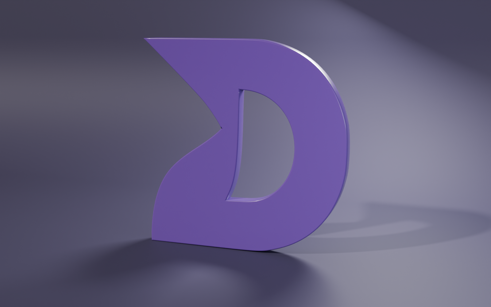
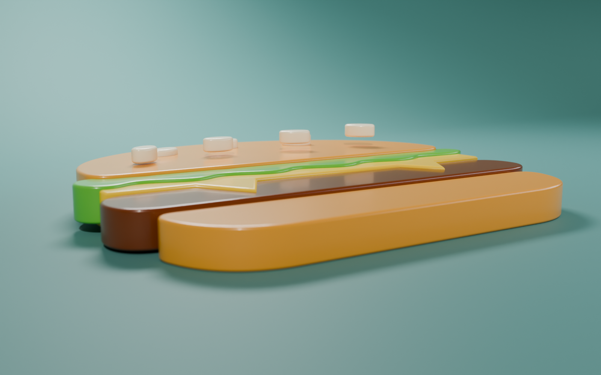
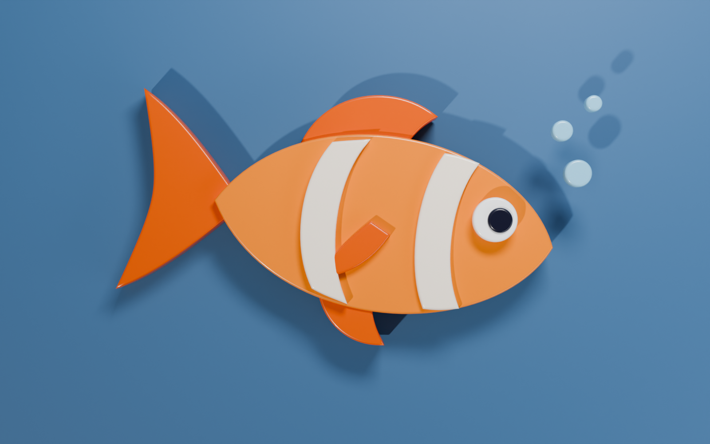

# 3 – Úvod do křivek: 3D loga z 2D obrázků

| drilex | Burger | Ryba |
| --- | --- | --- |
|  |  |  |

Zadání: [PGC – úloha 3](https://mirka.valik.sk/pgc/uloha_3/), převod loga ve formátu .svg do 3D
(vlastní logo, burger, ryba), využití křivek při modelování.

Videa k zadání:
- [Curves & Curve Modifier in Blender – Beginner Tutorial](https://www.youtube.com/watch?v=9xNdPA65dJo)
- [Rendering 2D Icons as 3D Objects in Blender](https://www.youtube.com/watch?v=zthvZvw-yJE)
- [How to Make YOUR Logo 3D in Blender](https://www.youtube.com/watch?v=hEEKRoEiy9s)
- [Video z kanálu in2vert](https://www.youtube.com/watch?v=YE93-pFhzNE)

## Soubory

Ke každému logu (`drilex`, `burger`, `fish`) patří:

| Soubor | Popis |
| --- | --- |
| `<logo>-logo.svg` | 2D logo (vstup) |
| `<logo>-logo.blend` | 3D logo z křivek (Blender 5.0+) |
| `<logo>-logo-preview.png` | Kamera 1: hlavní pohled (Cycles, 1600 × 1000) |
| `drilex-logo-front.png`, `drilex-logo-side.png` | Kamery 2 a 3 loga drilex: zepředu a z boku |
| `burger-logo-top.png`, `burger-logo-low.png`, `fish-logo-top.png`, `fish-logo-low.png` | Kamery 2 a 3 burgeru a ryby: shora a nízký záběr |

| drilex z boku | Burger nízko | Ryba shora |
| --- | --- | --- |
|  |  |  |

## Postup: z 2D obrázku 3D logo

1. **2D obrázek → SVG**
   - burger a ryba jsou nakreslené rovnou jako SVG (každá barva = jedna plocha),
   - logo **drilex** bylo PNG, převedené na vektor trasováním (*Trace Bitmap*, potrace):
     tvar „D“ podle průhlednosti, jednobarevný (#8A61C3).
2. **Import SVG**: *File → Import → Scalable Vector Graphics (.svg)*.
   Každá plocha z obrázku je samostatný **Curve** objekt (Bézierova křivka).
3. **Zvětšení**: SVG se importuje velmi malé. Křivky jsou rodičované k prázdnému objektu
   (*Empty*) a zvětšené na šířku 50 cm.
4. **Tloušťka**: *Object Data Properties → Geometry*:
   - **Extrude**: hlavní plochy 3 cm, malé detaily (oči, semínka, pruhy, bublinky) 1 cm,
   - **Bevel → Depth**: zaoblená hrana (Resolution 4), aby plast chytal odlesky,
   - **Fill Mode: Both**: vyplněná přední i zadní stěna.
5. **Vrstvy**: každá další plocha z SVG je o kousek výš, takže detaily vystupují nad podklad
   (semínka nad houskou, oko a pruhy nad tělem ryby).
6. **Materiály**: barva výplně z SVG (převedená ze sRGB), lesklý plast (*Roughness 0.3*, *Coat*).
7. **Poloha**: burger a ryba leží na podložce, logo drilex stojí (*Rotation X 90°*).

Křivky v .blend zůstaly křivkami (nejsou převedené na mesh), takže jde tloušťku, zaoblení
i tvar dál upravovat v *Edit Mode*.

## Světla, stíny a kamery

| Světlo | Typ | Účel |
| --- | --- | --- |
| Sun (key light) | Sun, úhel 2,5° | hlavní světlo zleva zepředu, ostré stíny pod logem |
| Fill light | Area 1,2 m | studené světlo zprava, prosvětlí stíny |
| Rim light | Area 0,5 m | zezadu shora, světlá hrana kolem loga |

Barevné zaoblené pozadí (*cyclorama*). Kamery jsou navázané na timeline markery (snímky 1–3):
- ležící loga (burger, ryba): `main` (3/4 pohled, hloubka ostrosti), `top` (shora),
  `low` (nízký záběr, ukazuje tloušťku),
- stojící logo (drilex): `main` (3/4 pohled), `front` (zepředu), `side` (z boku, vidět tloušťka).

Render: Cycles, 128 samplů, denoising, AgX.
