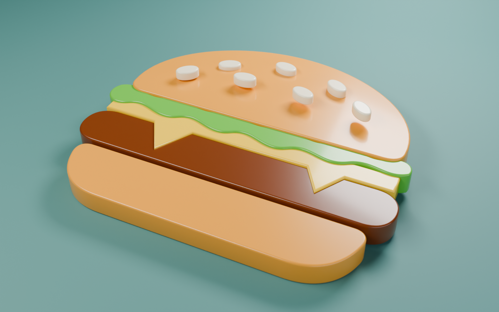
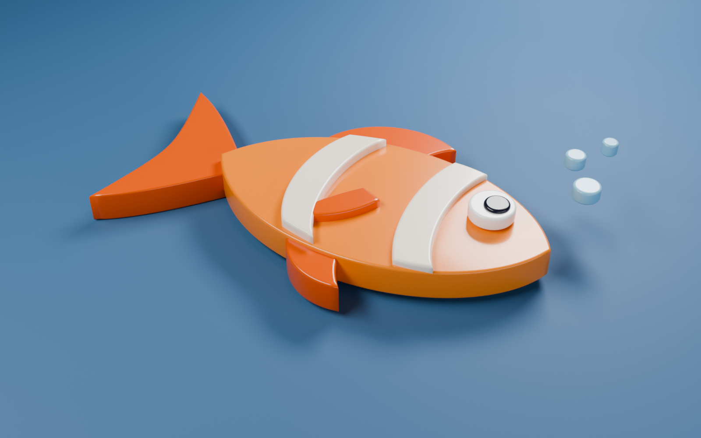

# 3 – Úvod do křivek: 3D loga z 2D obrázků

| Burger | Ryba |
| --- | --- |
|  |  |

Zadání: [PGC – úloha 3](https://mirka.valik.sk/pgc/uloha_3/), převod loga ve formátu .svg do 3D
(burger, ryba), využití křivek při modelování.

Videa k zadání:
- [Curves & Curve Modifier in Blender – Beginner Tutorial](https://www.youtube.com/watch?v=9xNdPA65dJo)
- [Rendering 2D Icons as 3D Objects in Blender](https://www.youtube.com/watch?v=zthvZvw-yJE)
- [How to Make YOUR Logo 3D in Blender](https://www.youtube.com/watch?v=hEEKRoEiy9s)
- [Video z kanálu in2vert](https://www.youtube.com/watch?v=YE93-pFhzNE)

## Soubory

| Soubor | Popis |
| --- | --- |
| `burger-logo.svg` | 2D logo burgeru (vstup) |
| `burger-logo.blend` | 3D logo burgeru (Blender 5.0+) |
| `burger-logo-preview.png` | Render (Cycles, 1600 × 1000) |
| `fish-logo.svg` | 2D logo ryby (vstup) |
| `fish-logo.blend` | 3D logo ryby (Blender 5.0+) |
| `fish-logo-preview.png` | Render (Cycles, 1600 × 1000) |

## Postup: z 2D obrázku 3D logo

1. **Import SVG**: *File → Import → Scalable Vector Graphics (.svg)*.
   Každá barevná plocha z obrázku se stane samostatným **Curve** objektem (Bézierova křivka).
2. **Zvětšení**: SVG se importuje velmi malé. Všechny křivky jsou rodičované k prázdnému
   objektu (*Empty*) a zvětšené na šířku 50 cm, logo leží na podložce.
3. **Tloušťka**: *Object Data Properties → Geometry*:
   - **Extrude**: hlavní plochy 3 cm, malé detaily (oči, semínka, pruhy, bublinky) 1 cm,
   - **Bevel → Depth**: zaoblená hrana (Resolution 4), aby plast chytal odlesky,
   - **Fill Mode: Both**: vyplněná přední i zadní stěna.
4. **Vrstvy**: každá další vrstva z SVG (podle pořadí v souboru) je o kousek výš, takže
   detaily vystupují nad podklad (semínka nad houskou, oko a pruhy nad tělem ryby).
5. **Materiály**: barva výplně z SVG převedená ze sRGB do lineárních barev, lesklý plast
   (*Roughness 0.3*, *Coat*).
6. **Scéna**: barevné zaoblené pozadí (*cyclorama*), tři plošná světla (key, fill, rim)
   a kamery `main` (3/4 pohled s hloubkou ostrosti), `top` a `low`.

Křivky v .blend zůstaly křivkami (nejsou převedené na mesh), takže jde tloušťku, zaoblení
i tvar dál upravovat v *Edit Mode*.
