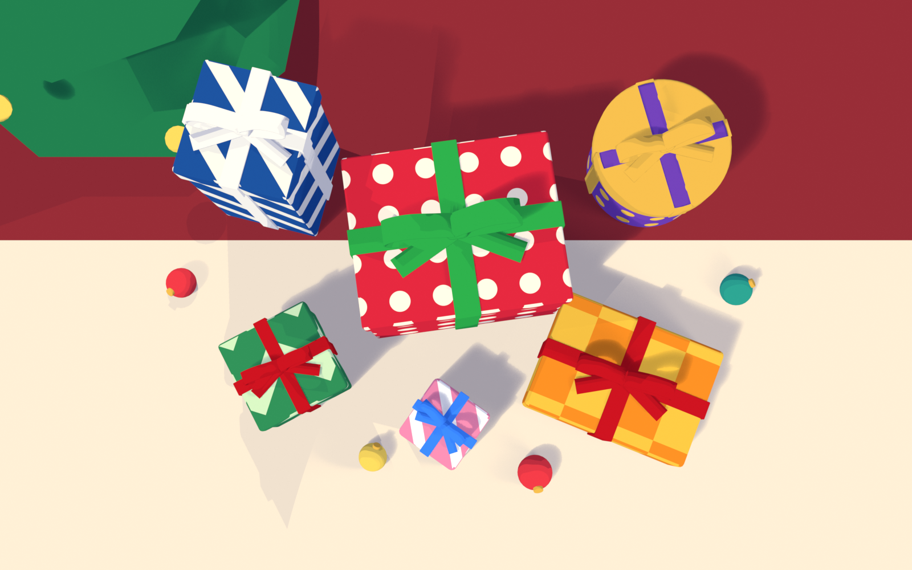

# 4 – Darček (stylizované vianočné darčeky)

Podľa tutoriálu [Stylized Christmas Presents 🎁 (Blender Tutorial)](https://www.youtube.com/watch?v=FMS5Ty1K6VI) (Ryan King Art).

## Súbory

| Súbor | Popis |
| --- | --- |
| `gift.blend` | Scéna s darčekmi (Blender 5.0+, **render: Eevee**) |
| `gift-preview.png` | Kamera 1: hlavný pohľad |
| `gift-top.png` | Kamera 2: pohľad zhora |
| `gift-closeup.png` | Kamera 3: detail mašle |
| `gift-low.png` | Kamera 4: nízky záber |

| Zhora | Detail mašle | Nízko |
| --- | --- | --- |
|  |  |  |

## Postup modelovania

**Krabice** (6 darčekov)
1. Kocka zmenšená na rozmer darčeka, hrany zaoblené (*Bevel*, 3 segmenty), *Shade Smooth*.
2. Veko: druhá, o trochu širšia kocka na vrchu krabice (prekrýva ju o 0,45 cm).
3. Okrúhly darček: valec s vekom, zaoblené hrany.

**Stuha**
- Dva pásy okolo krabice (cez os X aj Y), o niečo väčšie než krabica, aby neprenikali.
- Pri okrúhlom darčeku sú pásy orezané do tvaru valca cez *Boolean → Intersect*.

**Mašľa** (z kriviek)
1. Slučka: uzavretá 2D Bézierova krivka v tvare kvapky. *Extrude* je šírka stuhy, modifikátor *Solidify* je hrúbka.
2. Dve slučky otočené do strán, dva konce stuhy (otvorené krivky) a uzol (zaoblená kocka).
3. Všetky časti sú rodičované k *Empty*, takže sa mašľa posúva a otáča ako jeden celok.

**Baliaci papier**
- UV mapa sa premieta po stenách (*Cube Projection*) v skutočnej mierke, takže vzor má na všetkých darčekoch rovnakú veľkosť.
- Vzory sú procedurálne z UV súradníc: bodky (*Fraction → Length → Less Than*), pruhy, šachovnica (*Checker Texture*) a cik-cak (*Ping-Pong*).

## Stylizovaný (toon) materiál

Ako v tutoriáli: **Diffuse BSDF → Shader to RGB → Color Ramp (Constant)**.
- Color Ramp rozdelí svetlo na 4 ploché pásy: tieň (studený modrofialový), polotieň, svetlo a odlesk.
- Výsledok sa vynásobí farbou papiera alebo stuhy a ide do *Emission*.
- *Shader to RGB* funguje **len v Eevee**, preto sa scéna renderuje v Eevee.

## Vianočné pozadie

- Stromček z kužeľov (*Add → Cone*, Radius 2 = 0) s 26 guľami a hviezdou (vytiahnutá 2D krivka).
- Svetielka na stene: krivka s *Bevel Depth* (drôt) a svietiace žiarovky (*Emission*).
- Papierové vločky: 6 ramien s bočnými vetvičkami.
- Červená stena (*cyclorama*), krémová podlaha, vianočné gule na zemi.

## Svetlá, tiene a kamery

| Svetlo | Typ | Účel |
| --- | --- | --- |
| Sun (key light) | Sun, uhol 4° | hlavné svetlo, ostré tiene darčekov |
| Fill light | Area 1,5 m | studené prisvetlenie sprava |
| Tree glow | Point | teplé svetlo od stromčeka |
| World | Background | slabé okolité svetlo |

Kamery sú naviazané na markery na časovej osi (snímky 1–4, *Marker → Bind Camera to Markers*).
Render: Eevee, 64 vzoriek, tiene a ambient occlusion.
