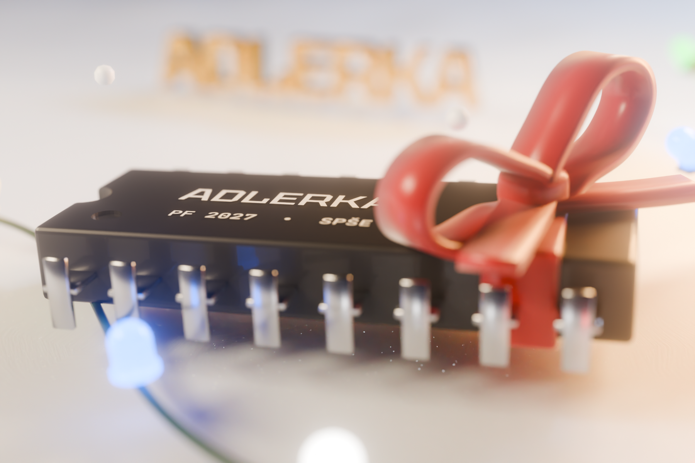
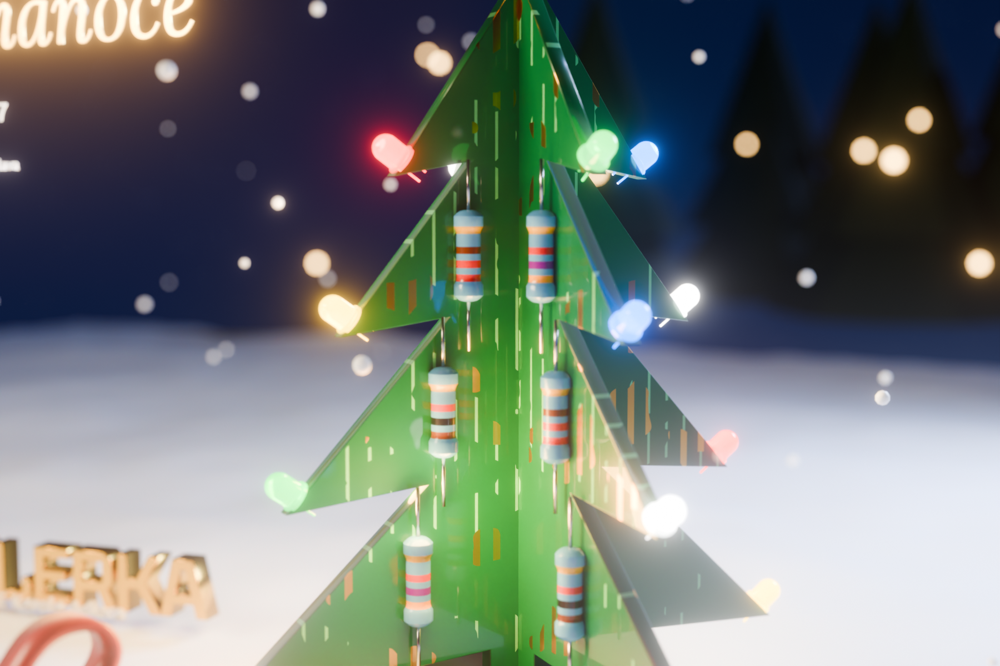

# 5 – Vianočná pohľadnica: Adlerka

Zadanie: vianočná pohľadnica s tematikou **Adlerky** (SPŠE Karola Adlera). Scéna má
3 vlastnoručne vymodelované modely, materiály, osvetlenie a nastavenú kameru na render.

Téma je elektrotechnika v snehu: vianočný stromček z dosky plošných spojov,
integrovaný obvod zabalený ako darček a reťaz LED svetielok.

## Súbory

| Súbor | Popis |
| --- | --- |
| `postcard.blend` | Scéna pohľadnice (Blender 5.0+, Cycles), fonty sú zabalené v súbore |
| `postcard.png` | Kamera 1: pohľadnica (1800 × 1200, pomer 3 : 2) |
| `postcard-chip.png` | Kamera 2: detail čipu ADLERKA |
| `postcard-tree.png` | Kamera 3: detail stromčeka |

| Detail čipu | Detail stromčeka |
| --- | --- |
|  |  |

## Modely (vlastnoručne vymodelované)

**1. Stromček z dosky plošných spojov (PCB)**
- Obrys stromčeka nakreslený ako 2D krivka (3 poschodia, ovisnuté konáre), *Extrude* 3,2 mm = hrúbka dosky.
- Dve rovnaké dosky zasunuté do seba krížom (otočené o 90°), stojan je zaoblená kocka.
- Na doske je potlač **ADLERKA / REV 2027** (textový objekt).
- **LED diódy** na koncoch konárov: profil roztočený okolo osi (*Spin / Screw*: lem, telo, kupolka) a dve nožičky (valce).
- **Rezistory** ako ozdoby: roztočený profil (hrubšie konce, tenší stred), farebné prúžky a nožičky.
- Hviezda na vrchu: vytiahnutá 2D krivka so zaobleným okrajom (*Bevel*), zlatý kov.

**2. Integrovaný obvod DIP-16 ako darček**
- Puzdro: zaoblená kocka. Výrez na strane pinu 1 a jamka sú vyrezané *Booleanom (Difference)*.
- 16 nožičiek: rameno a ohnutá nožička z malých kvádrov.
- Potlač **ADLERKA / PF 2027 • SPŠE**, okolo puzdra červená stuha a mašľa (krivky z úlohy 4).

**3. Reťaz LED svetielok**
- Drôt je 3D Bézierova krivka s *Bevel Depth*.
- 19 LED rozmiestnených v rovnakých rozostupoch po dĺžke krivky, natočených podľa smeru drôtu.

Ďalej v scéne: 3D nápis **ADLERKA** (text s *Extrude* a *Bevel*) zapichnutý v snehu, ihličnany v pozadí a padajúci sneh.

## Materiály

| Materiál | Ako |
| --- | --- |
| PCB | zelená spájkovacia maska, procedurálne medené cesty (*Noise* + čiary z *Fract*) a zlaté plôšky, *Bump*, lak (*Coat*) |
| LED | farebné sklo (*Transmission*) so svietením (*Emission*), 5 farieb |
| Rezistory | modré telo s farebnými prúžkami (*Object Z → Color Ramp Constant*), 3 hodnoty: 1k, 4k7, 220 Ω |
| Čip | čierny epoxid, cínované kovové nožičky, biela potlač |
| Sneh | biela s *Subsurface*, *Bump* a trblietky (*Voronoi → Emission*) |
| Nočná obloha | prechod tmavomodrej (*Gradient*) a hviezdy (*Voronoi*) vo *World* shaderi |

## Osvetlenie

| Svetlo | Typ | Účel |
| --- | --- | --- |
| Moon | Sun, uhol 1°, modrastý | mesačné svetlo, ostré tiene na snehu |
| Key light (warm) | Area | teplé hlavné svetlo spredu zľava |
| Rim light | Area | studený obrys stromčeka zozadu |
| Tree glow 1, 2 | Point | teplé svetlo od LED na sneh |
| LED, svetlá v diaľke | Emission | svietiace diódy, bokeh v pozadí |

**Kompozícia** (*Compositor*): *Glare → Bloom*, žiara okolo LED a svetiel.

## Kamera

- `Camera 1 - postcard`: 40 mm, f/5,6, ostrí na stromček, pozadie je rozmazané (hĺbka ostrosti).
- Text pohľadnice (**Veselé Vianoce**, **a úspešný nový rok 2027**, **praje Adlerka**) je rodičovaný ku kamere, takže je vždy v zábere.
- `Camera 2 - chip detail`, `Camera 3 - tree detail`: detailné zábery.
- Kamery sú naviazané na markery na časovej osi (snímky 1–3).

Render: Cycles, 192 vzoriek, denoising, AgX, 1800 × 1200.
