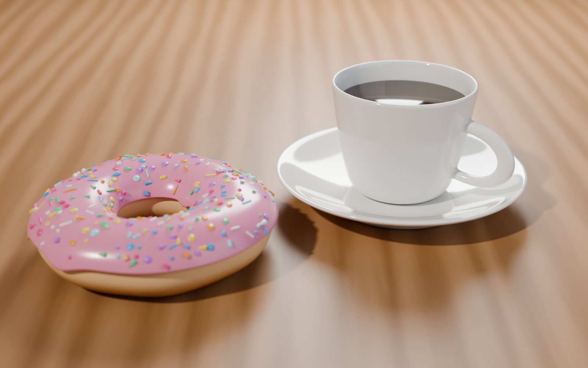
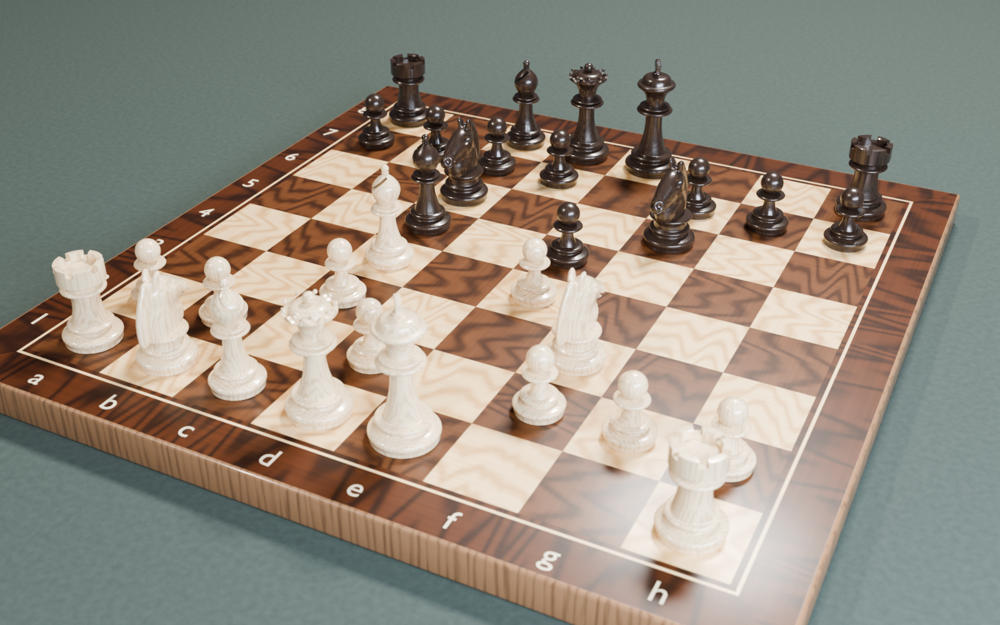

# Blender introduction

Školní projekty v Blenderu. Každý projekt má vlastní složku s `.blend` souborem, náhledem a dokumentací.

| # | Projekt | Náhled |
| --- | --- | --- |
| 1 | [Donut, šálek a podšálek](1-donut/) |  |
| 2 | [Šachy: figurka (kůň) a šachovnice](2-chess/) |  |
| 3 | [Křivky: 3D loga z SVG (drilex, burger, ryba)](3-logos/) |  |
